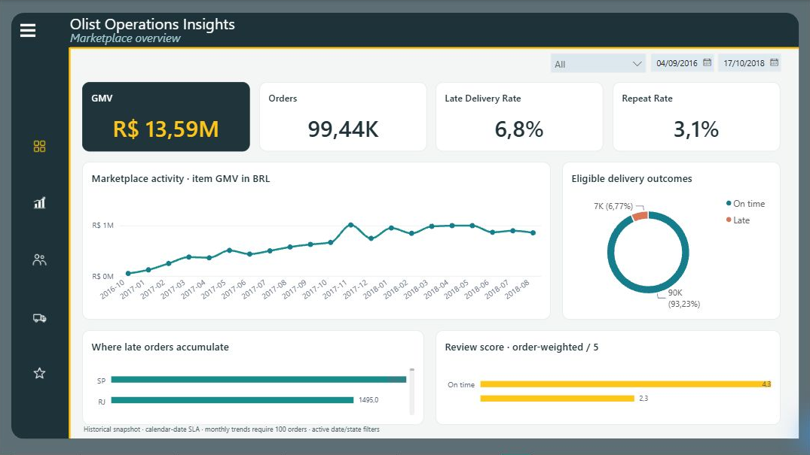
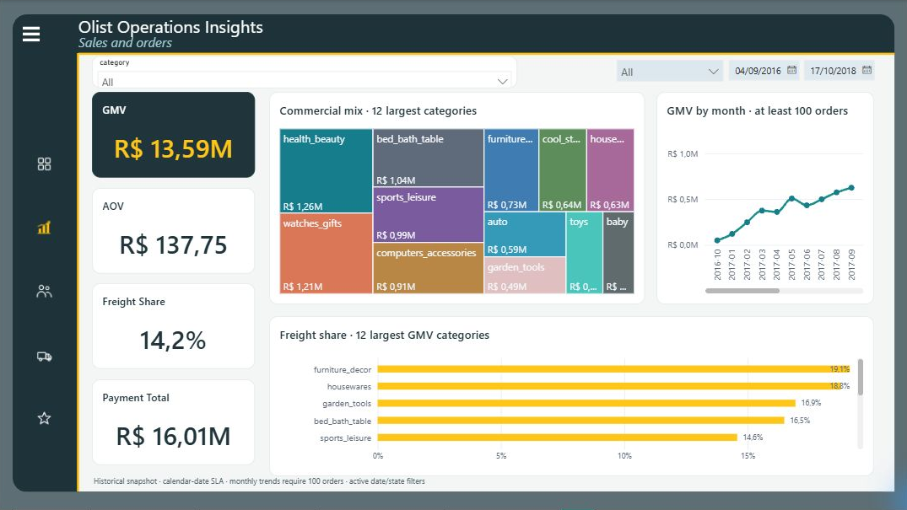
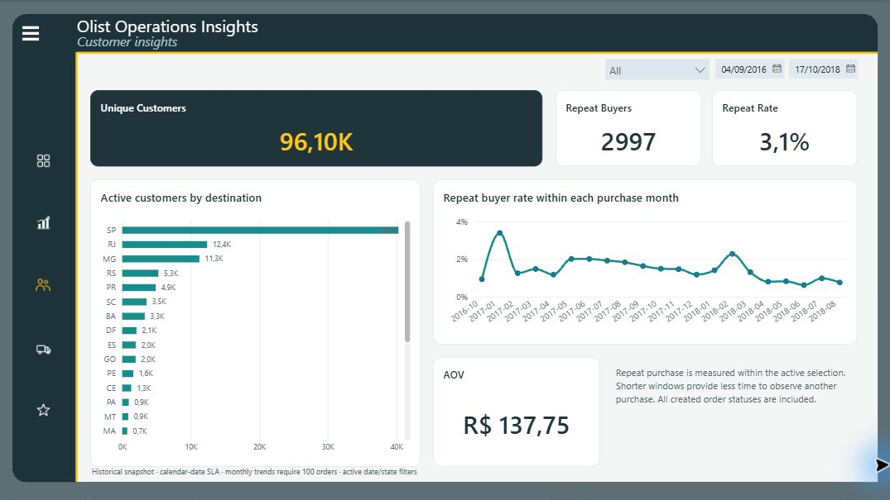
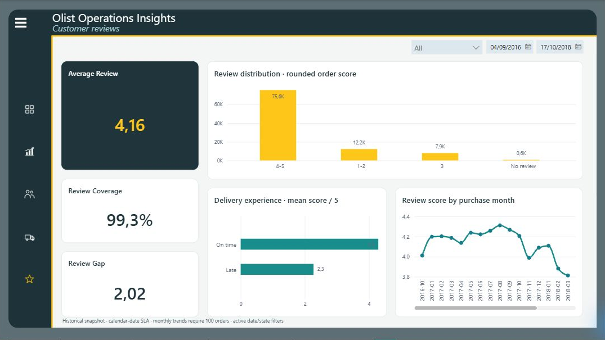

# Olist Operations Diagnostic

## 1. Business question

**Where should marketplace operations test delivery exception management to reduce missed delivery promises and improve customer experience?**

This BA/DA case study supports logistics, customer experience and seller-management decisions using Olist orders placed between **4 September 2016 and 17 October 2018**.

**Tools:** SQL · Python · Power BI

[Download Power BI report](https://github.com/Manh2k5QH/olist-operation-portfolio/raw/refs/heads/main/project.pbix) · [Executive memo](docs/12_executive_memo.pdf) · [DAX measures](dax/measures.md)

## 2. Data sources

The [Olist Brazilian E-Commerce Public Dataset](https://www.kaggle.com/datasets/olistbr/brazilian-ecommerce) contains **9 supplied CSV files and 1,550,922 source rows**, including **99,441 orders** and **112,650 item rows**. Each source has a different observation unit; rows cannot be treated as interchangeable transactions.

The publisher lists **CC BY-NC-SA 4.0**. See [attribution and transformations](DATA_ATTRIBUTION.md). Raw CSVs are excluded from this repository.

<details>
<summary>Source tables and row counts</summary>

| Source | Rows | Observation unit |
|---|---:|---|
| Orders | 99,441 | Order |
| Customers | 99,441 | Order-linked customer record |
| Order items | 112,650 | Item within an order |
| Payments | 103,886 | Payment sequence |
| Reviews | 99,224 | Review submission |
| Products | 32,951 | Product |
| Sellers | 3,095 | Seller |
| Geolocation | 1,000,163 | Geolocation observation |
| Category translation | 71 | Category translation |

The snapshot includes sparse edge months. The [data dictionary](docs/05_data_dictionary.md) and [source manifest](evidence/reproducibility_manifest.json) describe the analyzed copy.

</details>

## 3. Preparation and analytical choices

- **Define delivery promises by calendar date.** Same-date delivery counts as on time. The eligible population is **96,470 delivered orders with both dates**; 8 delivered orders with incomplete dates are excluded.
- **Prevent duplicated outcomes and amounts.** Aggregate reviews and item financials by order before joining. Count seller–order pairs once and identify people with `customer_unique_id`.
- **Keep financial populations explicit.** Item GMV includes all item statuses. Delivery metrics use the eligible delivery population. Freight share is the ratio of total freight to total item price plus freight.

[Data lineage](images/diagram-data-lineage.png) · [KPI definitions](docs/04_kpi_tree.md) · [SQL](sql/)

## 4. Key findings

1. **Late delivery is associated with lower review scores.** **6,534 of 96,470** eligible orders were late (**6.77%**). Reviewed late orders averaged **2.27/5**, versus **4.29/5** for on-time orders—a **2.02-point gap** supporting further investigation.
2. **Rate and volume suggest different geographic priorities.** SP recorded **1,820 late orders at 4.49%**; RJ recorded **1,495 at 12.11%**. A pilot should consider both operational scale and delivery risk.
3. **Observed repeat purchasing is limited.** **2,997 of 96,096 customers (3.12%)** placed multiple orders within the snapshot. Unequal follow-up means this is a snapshot baseline, not a fixed-window retention rate.

## Dashboard



*Marketplace activity, eligible delivery outcomes and customer experience. Actual Power BI Desktop capture using the full snapshot and all states.*

<details>
<summary>View the other four report pages</summary>

### Sales and orders



*Category contribution, monthly item GMV and freight economics.*

### Customer insights



*Distinct customers, geographic reach and repeat activity within the selected window.*

### Delivery performance


*Destination risk, monthly late rates, guarded MoM comparison and seller exposure.*

### Customer reviews



*Order-weighted review scores, review coverage and the late/on-time comparison.*

</details>

## 5. Recommendation

**Assess SP and RJ for a controlled delivery-exception pilot**, provided current-status events, assigned owners and handling capacity are available.

The proposed workflow flags unconfirmed deliveries **3 calendar days before ETA**, subject to operational validation. Compare late delivery outcomes alongside cancellations, review coverage, workload and handling cost before deciding whether to expand. See the [proposed pilot and workflow](docs/11_to_be_process.md).

## 6. Known limitations

- **Historical, final-status data:** live intervention requires current events and operational validation of the calendar-date promise assumption.
- **Association rather than causation:** the review gap does not establish intervention effects or responsibility for a seller or carrier.
- **Incomplete economics:** GMV, payments and customer freight charges do not establish profit, actual delivery cost or pilot savings.
- **Unequal coverage:** sparse months, small samples, missing reviews and different customer observation windows affect comparisons. Stakeholder roles and approvals are portfolio simulations.

## Project deliverables

- [Problem statement](docs/01_problem_statement.md) and [executive memo](docs/12_executive_memo.pdf).
- [Business requirements](docs/07_BRD.md), [user stories](docs/08_user_stories.md) and [traceability matrix](docs/10_RTM.md).
- [AS-IS process](docs/03_as_is_process.md), [TO-BE process](docs/11_to_be_process.md) and editable [draw.io diagrams](docs/diagrams/).
- [27 DAX measures](dax/measures.md), [SQL analysis](sql/analysis/) and [aggregate evidence](evidence/).

## Validation

**26 native SQL–DAX comparisons and all 31 analytical queries passed.** A relocated, cache-free Power BI refresh was also tested. See [executed UAT](docs/14_dashboard_uat.md) for test scope and results; [operational readiness](docs/16_operational_handoff.md) remains separate from historical analytical acceptance.

## How to view and run

Download [project.pbix](https://github.com/Manh2k5QH/olist-operation-portfolio/raw/refs/heads/main/project.pbix) and open it in **Power BI Desktop**. Imported data is embedded, so the report can be viewed without refreshing.

<details>
<summary>Refresh the report or reproduce the SQL evidence</summary>

Download the nine source CSV files from the linked Olist dataset and place them in `data/`.

To refresh Power BI, open **Transform data**, edit `ProjectRoot` in the **OlistAll** query to the local project folder, and refresh.

To regenerate the analytical evidence, run from the repository root with **Python 3.12**:

```powershell
python -m pip install -r requirements.txt
python -I scripts/profile_olist.py
python -I scripts/check_metrics.py
```

The profiler writes to `evidence/` and preserves authored reports and images.

</details>
