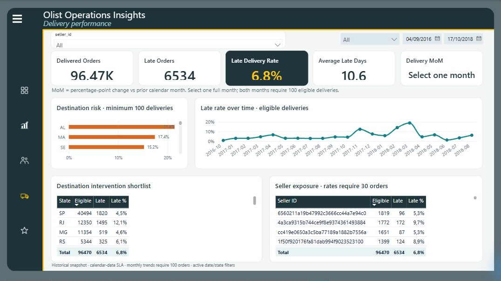
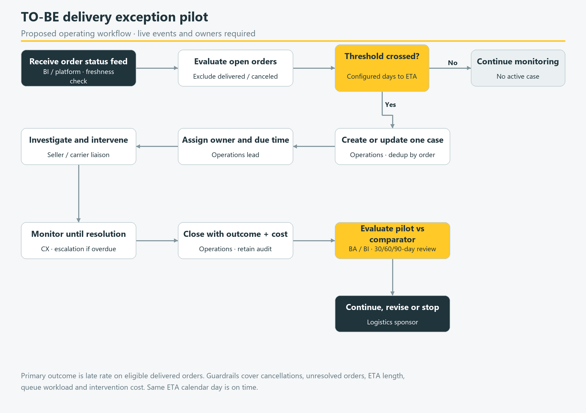

# Olist Operations Diagnostic

**Business Analysis · Data Analysis · SQL · Python · Power BI**

[Download Power BI report](https://github.com/Manh2k5QH/olist-operation-portfolio/raw/refs/heads/main/project.pbix) · [Executive memo](docs/12_executive_memo.pdf) · [DAX measures](dax/measures.md) · [BA requirements](docs/07_BRD.md)

A historical marketplace case study connecting delivery performance and customer experience to a proposed exception-management pilot. Includes five dashboard pages, traceable BA deliverables and independently checked metrics.

## 1. Business question

**Where should marketplace operations test delivery exception management to reduce missed delivery promises and improve customer experience?**

This BA/DA portfolio supports logistics operations, customer experience, seller management and commercial decision-makers. It analyzes the supplied Olist order snapshot from **4 September 2016 to 17 October 2018**, then translates the findings into governed KPIs, requirements, reporting and a proposed pilot.

## 2. Data sources

The source is the supplied nine-file snapshot of the **Olist Brazilian E-Commerce Public Dataset**. Its purchase-date coverage includes sparse edge months. The publisher lists CC BY-NC-SA 4.0 on the [original dataset page](https://www.kaggle.com/datasets/olistbr/brazilian-ecommerce). [Attribution and transformation notes](DATA_ATTRIBUTION.md) identify the local copy and distribution scope.

The **1,550,922 source rows** represent different business grains.

| Source file | Rows | Observation unit |
|---|---:|---|
| olist_orders_dataset.csv | 99,441 | Order |
| olist_customers_dataset.csv | 99,441 | Order-linked customer record |
| olist_order_items_dataset.csv | 112,650 | Item within an order |
| olist_order_payments_dataset.csv | 103,886 | Payment sequence |
| olist_order_reviews_dataset.csv | 99,224 | Review submission row |
| olist_products_dataset.csv | 32,951 | Product |
| olist_sellers_dataset.csv | 3,095 | Seller |
| olist_geolocation_dataset.csv | 1,000,163 | Geolocation observation |
| product_category_name_translation.csv | 71 | Category translation |

## 3. Preparation and analytical choices

The analysis validates keys, parses dates, reconciles financial populations and creates delivery, seller and category marts. Three choices materially affect the result.

- **Calendar-date delivery promise.** Delivery on the estimated date counts as on time. The delivery KPI uses **96,470** delivered orders with both dates, excluding **8** delivered orders whose dates are incomplete. Comparing timestamps would classify another **1,292** same-date deliveries as late.
- **Respect each business grain.** Reviews and item amounts are aggregated by order before joining. Seller delivery exposure counts each seller–order pair once. Repeat behavior uses `customer_unique_id`, since one person can have several order-linked `customer_id` values.
- **Preserve financial meaning.** Item GMV sums price across all item statuses. Delivered GMV and delivery-eligible GMV are labeled separately. Freight share uses total freight divided by total item price plus freight. Geolocation is excluded from direct joins because postal prefixes repeat.


*The lineage shows source grains and the aggregation boundaries that prevent duplicated amounts and outcome counts. [Edit the diagram](docs/diagrams/data-lineage.drawio).*

## 4. Key findings

1. **Missed promises are associated with lower review scores.** **6,534 of 96,470** eligible deliveries were late (**6.77%**). Reviewed late orders averaged **2.27/5**, compared with **4.29/5** for on-time orders. The **2.02-point gap** makes delivery reliability a candidate for a controlled operational test.
2. **Rate and volume lead to different geographic priorities.** SP had **1,820** late orders at **4.49%**, while RJ had **1,495** at **12.11%**. AL had the highest observed rate at **21.41%**, with **85 late orders among 397** deliveries. Selecting a pilot requires both scale and a feasible operational action.
3. **Seller reach and repeat behavior need careful interpretation.** The **619 highest-volume sellers** account for approximately **82.64% of item rows**, suggesting concentrated coaching reach. **2,997 of 96,096** customers placed more than one order (**3.12%**), but follow-up differs between customers. Seller exposure and snapshot repeat share guide investigation and require additional evidence for responsibility or intervention effects.

## Dashboard and reporting

The five-page report covers overview, sales, customers, delivery and customer experience. Download [project.pbix](project.pbix) and open it in Power BI Desktop; imported data is embedded for immediate viewing. Read [the 27 exported DAX measures](dax/measures.md) to inspect calculations without opening Desktop.


*Overview combines marketplace activity, delivery outcomes and customer experience in an executive composition.*


*Sales uses a vertical KPI rail, a dynamic top-12 category treemap and freight economics. Category selection filters item GMV, AOV and freight; Payment Total retains the selected order/date/state scope without invented category allocation.*


*Customers emphasizes distinct people, geographic reach and repeat activity within the selected observation window.*



*Delivery pairs state risk and monthly trends with destination and seller shortlists. Monthly trends require 100 orders; seller rates require 30 eligible orders.*


*Reviews combines order-weighted scores, review coverage, the score distribution and the late/on-time comparison.*

All five images are cropped captures from the actual redesigned Power BI Desktop report, using all states and the full snapshot. [Release evidence](evidence/report_release.json), [executed UAT](docs/14_dashboard_uat.md) and [completion review](docs/13_completion_review.md) distinguish verified behavior from remaining acceptance work.

## 5. Recommendation

Run a **focused delivery exception pilot** in a destination group with sufficient actionable volume, reliable current-status events and assigned operations capacity. SP and RJ are candidates for readiness assessment. The snapshot alone does not establish an origin–destination route or carrier cause.

The proposed queue begins **3 calendar days before ETA**, records an owner and response deadline, and tracks actions through closure. Pilot launch depends on validating the threshold, staffing, consented communications, an appropriate comparator, sample size and outcome follow-up.

Measure calendar late rate alongside cancellation/unresolved outcomes, ETA length, review coverage, queue burden and handling cost. A **10% relative reduction** is a planning assumption. At the overall historical baseline this corresponds to about **6.10%**, or **653 fewer late orders across the full snapshot**. Pilot sizing must use the selected cohort. Financial savings remain unestimated pending cost and outcome evidence.



*The target process makes ownership, escalation and outcome logging explicit. [Edit the diagram](docs/diagrams/to-be.drawio).*

## 6. Known limitations

- The snapshot is historical and contains final statuses. A live exception workflow requires event freshness, intervention logging and operational ownership.
- Order-level timestamps cannot establish responsibility for each seller, package or carrier. Multi-seller orders make this particularly important.
- Delivery and review differences are descriptive associations. Treatment assignment and outcome follow-up are needed to estimate intervention effects.
- GMV, payments and customer freight charges do not provide platform profit, contribution margin or actual transport cost. Payment value exceeds item plus freight by **R$165,318.88**, requiring order-level reconciliation.
- Review coverage and repeated review rows affect weighting. Group comparisons use per-order means and show reviewed counts.
- The **3.12%** repeat metric includes all created-order statuses and unequal observation windows. A retention outcome should use a fixed follow-up window.
- Sparse edge months, small state/seller/category samples and missing category names affect interpretation. Category freight share must be aggregated as a ratio of totals.
- Calendar-date promise semantics are an adopted analytical assumption pending operational validation. All stakeholder roles and approvals are portfolio simulations.

## BA deliverables and how to review

Read the [problem and decision gates](docs/01_problem_statement.md), [stakeholders and RACI](docs/02_stakeholders_raci.md), [AS-IS](docs/03_as_is_process.md), [KPI contract](docs/04_kpi_tree.md), [data dictionary](docs/05_data_dictionary.md) and [findings](docs/06_findings_log.md). The [BRD](docs/07_BRD.md), [15 user stories](docs/08_user_stories.md), [business rules](docs/09_business_rules.md) and [RTM](docs/10_RTM.md) trace needs to evidence and acceptance cases.

The [RTM JSON](docs/10_RTM.json) is the canonical requirement register. The [Excel RTM](docs/10_RTM.xlsx) uses the same 15 IDs. The [pilot design](docs/11_to_be_process.md) explains readiness and expansion, while the [executive memo](docs/12_executive_memo.md) and [PDF](docs/12_executive_memo.pdf) present the decision request.

Editable draw.io sources are included for [data lineage](docs/diagrams/data-lineage.drawio), [AS-IS](docs/diagrams/as-is.drawio) and [TO-BE](docs/diagrams/to-be.drawio). The public package contains the final PBIX, images, SQL, Python checks, aggregate evidence and BA documents. Raw CSVs, cached models, alternative reports and development drafts are excluded.

## Reproduce the evidence

Download the nine CSV files from the [Olist dataset](https://www.kaggle.com/datasets/olistbr/brazilian-ecommerce), place them in `data/`, then run from the repository root with Python and the declared dependencies.

```powershell
python -m pip install -r requirements.txt
python -I scripts/profile_olist.py
python -I scripts/check_metrics.py
```

The profiler writes to `evidence/` and preserves authored reports and images. `evidence/kpis.json` contains headline results, and the small evidence CSVs expose the underlying populations. Raw CSVs are excluded; see DATA_ATTRIBUTION.md for the source license and transformations.

The analytical stack is **DuckDB SQL, Python and Power BI**. Documentation uses Markdown, Excel and PDF, with editable diagrams created through draw.io.

## Acceptance and handoff

The historical portfolio has passed 26 native SQL–DAX comparisons and a relocated, cache-free Desktop refresh, alongside all 31 analytical queries. The Delivery page includes a guarded MoM indicator. See [executed UAT](docs/14_dashboard_uat.md), [completion assessment](docs/13_completion_review.md), [operational handoff](docs/16_operational_handoff.md) and [release hashes](evidence/report_release.json). Live pilot implementation and stakeholder approvals remain separate dependencies.

To refresh the PBIX on another machine, open Transform data, edit the `ProjectRoot` value in the OlistAll query to the local repository folder, and refresh. The initial embedded report can be viewed without refreshing. Python evidence generation requires Python 3.12 and the pinned DuckDB dependency.
