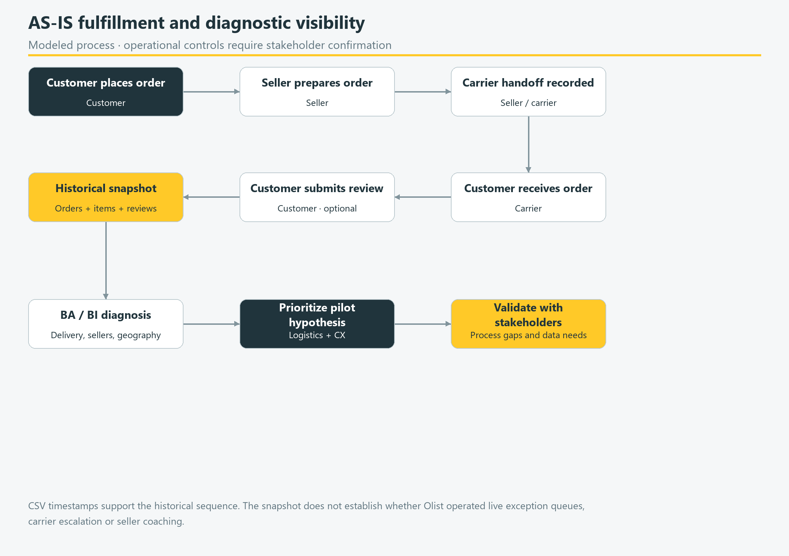

# AS-IS order lifecycle and evidence gaps
Version 3.0 · 27 November 2026 · Historical portfolio exercise · Stakeholder decisions remain proposed.
## What the snapshot supports

Orders expose purchase, approval, carrier-handoff, customer-delivery and estimated-delivery timestamps, plus final status. Items expose a seller shipping deadline. These fields support elapsed-time analysis and final delivery classification. They do not establish how Olist staff monitored exceptions or which systems were in use.

## Lifecycle and control points

| Stage | Observable evidence | Analytical check | Discovery question |
|---|---|---|---|
| Purchase | order_purchase_timestamp | Missing or invalid date and time coverage | Which timezone is authoritative? |
| Approval | order_approved_at | Time since purchase | Are payment-specific settlement rules recorded? |
| Preparation and handoff | shipping_limit_date; order_delivered_carrier_date | Compare deadlines cautiously at order/item grain | Is the event tied to a specific package and seller? |
| Transport | Customer delivery timestamp | Handoff-to-delivery interval where both events exist | Which carrier and intermediate events are available? |
| Delivery | order_status and delivered date | Calendar promise breach, missing-date coverage | How are partial deliveries represented? |
| Review | review_score and review timestamps | Multiple rows, coverage and score association | Are reviews submitted before final delivery? |

## Diagnosed gaps

- Delivery reliability differs across destination states and review groups.
- Seller exposure is measurable from the distinct seller–order bridge. Shipment responsibility requires additional evidence.
- Source rows have different grains, so direct joins can multiply amounts and review weighting.
- The snapshot is historical. A live exception queue requires event freshness, ownership and intervention logs.

The operational gaps above are discovery items. This exercise does not claim that Olist lacked tracking systems, customer recovery or seller management. The [TO-BE](11_to_be_process.md) proposes controls to validate with process owners.
