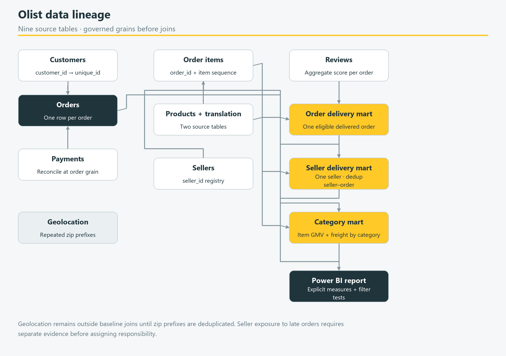

# KPI tree and calculation contract
Version 3.0 · 27 November 2026 · Historical portfolio exercise · Stakeholder decisions remain proposed.
## Business objective and measurable outcomes

The proposed pilot objective is to reduce missed calendar-date promises while keeping cancellations, ETA length and intervention cost within agreed limits. Merchandise value and freight charges provide business context. Customer reviews provide a secondary outcome with explicit coverage.

The outcome chain is intervention coverage → completed actions before breach → delivery reliability. This is a testable pilot hypothesis. Historical data establishes a baseline and descriptive relationships.

## Governed metric definitions

| ID | Metric | Population and calculation | Snapshot baseline |
|---|---|---|---|
| KPI-001 | Item GMV | SUM item price across all item rows and statuses | R$13,591,643.70 |
| KPI-002 | Item AOV | KPI-001 / distinct order_id with item rows | R$137.75 over 98,666 orders |
| KPI-003 | Freight share | SUM freight / SUM(price + freight), same item population | 14.21% |
| KPI-004 | Calendar late rate | Delivered orders with actual DATE > estimated DATE / delivered orders with both dates | 6,534 / 96,470 = 6.77% |
| KPI-005 | Review gap | Mean order-level score on time minus mean order-level score late, eligible delivery population | 4.29 − 2.27 = 2.02 points |
| KPI-006 | Average review | Average of per-order AVG(review_score), eligible delivered orders with reviews | 4.1562/5 over 95,824 reviewed eligible orders; display reviewed count |
| KPI-007 | Snapshot multi-order share | Customers with >1 distinct created order / customers with a created order, customer_unique_id | 2,997 / 96,096 = 3.12% |
| KPI-008 | Seller late exposure | Distinct late seller–order pairs / eligible delivered seller–order pairs | Report seller-level denominator |
| KPI-009 | Calendar delay of late orders | Average DATE(actual) − DATE(estimate), restricted to late orders | 10.62 days |
| KPI-010 | Review coverage | Eligible orders with a score / eligible delivery orders | 95,824 / 96,470 = 99.33% |

## Population and null policy

- Delivery eligibility requires status delivered and both valid delivery dates. The snapshot has 96,478 delivered orders and excludes 8 from the delivery-rate denominator.
- Same-date delivery is on time. Midnight estimates are treated as a date-only customer promise. This is a portfolio assumption pending process-owner confirmation.
- An unknown delivery result is null, rather than an on-time observation. It stays outside rate numerators and denominators.
- Reviews are first averaged per order. The late group has 6,381 reviewed orders of 6,534, and the on-time group has 89,443 of 89,936. An absent score remains missing.
- Calendar-day difference counts date boundaries. Elapsed duration counts seconds / 86,400. For late orders the elapsed mean is 11.30 days. These fields have distinct names.
- Seller exposure belongs to one row per seller–order. A multi-seller order contributes to each relevant seller, so totals across sellers exceed unique marketplace orders.
- Item GMV includes canceled and other non-delivered statuses. Delivered item GMV is R$13,221,498.11. Delivered orders eligible for delivery metrics contain R$13,220,248.93. Report names and visual subtitles identify the population.

## Governance and pilot targets

BI owns implementation and parity checks. Logistics owns SLA interpretation, CX owns review interpretation and commercial owns financial meaning. BA records change impact across SQL, evidence, DAX, visuals and findings.

A 10% relative late-rate reduction is an illustrative pilot planning assumption. On an equal baseline it would reduce 6.77% to approximately 6.10%. Statistical power, sample size, intervention capacity and follow-up must be established for the selected cohort. Review lift, repeat-purchase lift and savings have no validated target in the snapshot.

Targets for the live pilot also include queue coverage, action completion before ETA, duplicate-alert rate, handling cost and feed freshness. They require new operational data and business acceptance.
