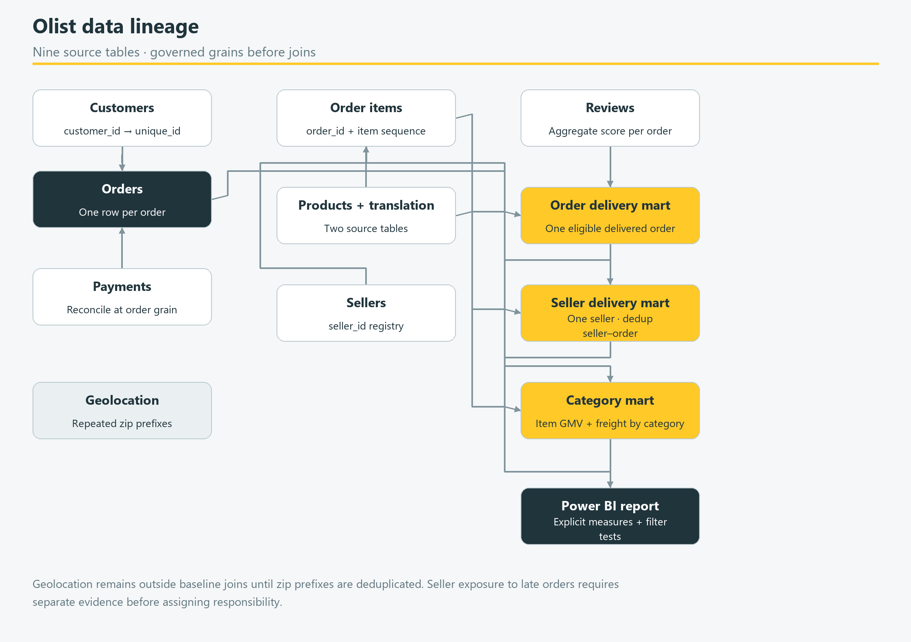

# Data dictionary and modeling contract
Version 3.0 · 27 November 2026 · Historical portfolio exercise · Stakeholder decisions remain proposed.
## Source inventory

The supplied Olist snapshot has nine CSV files and 1,550,922 rows. The row count is the sum of file data rows, rather than unique business entities.

| File prefix | Rows | Grain and keys |
|---|---|---|
| olist_orders_dataset | 99,441 | One order, order_id |
| olist_customers_dataset | 99,441 | One order-linked customer record, customer_id |
| olist_order_items_dataset | 112,650 | One item, order_id + order_item_id |
| olist_order_payments_dataset | 103,886 | One payment sequence, order_id + payment_sequential |
| olist_order_reviews_dataset | 99,224 | One review submission row, review_id can repeat |
| olist_products_dataset | 32,951 | One product, product_id |
| olist_sellers_dataset | 3,095 | One seller, seller_id |
| olist_geolocation_dataset | 1,000,163 | One geolocation observation, zip prefix repeats |
| product_category_name_translation | 71 | Category translation lookup |

## Order and customer fields

| Entity | Fields | Meaning and handling |
|---|---|---|
| Orders | order_id; customer_id | Order key and link to order-specific customer record |
| Orders | order_status | Lifecycle status, including delivered, canceled, shipped, unavailable and processing |
| Orders | order_purchase_timestamp; order_approved_at | Purchase and approval events, parsed with invalid values retained as null |
| Orders | order_delivered_carrier_date | Order-level handoff event, with limits for attributing individual seller dispatch |
| Orders | order_delivered_customer_date | Actual customer-delivery event |
| Orders | order_estimated_delivery_date | Customer promise, interpreted as calendar date for SLA classification |
| Customers | customer_id | Join orders to customer attributes |
| Customers | customer_unique_id | Customer business key across orders, used for repeat behavior |
| Customers | customer_state; customer_city | Destination attributes, often useful for descriptive segments |
| Customers | customer_zip_code_prefix | Postal prefix, preserve as categorical text including leading zeros |

## Item, payment, review and reference fields

| Entity | Fields | Meaning and handling |
|---|---|---|
| Items | order_id; order_item_id | Composite item key |
| Items | product_id; seller_id | Product and seller references |
| Items | shipping_limit_date | Item dispatch deadline, distinct from customer promise |
| Items | price | Merchandise amount charged on an item line, Brazilian reais |
| Items | freight_value | Customer-facing item freight charge, Brazilian reais |
| Payments | payment_sequential; payment_type; payment_installments | Multiple methods or sequences may belong to an order |
| Payments | payment_value | Payment amount, reconcile at order grain before comparison with item amounts |
| Reviews | review_id; order_id | Submission identity and order link, review_id has duplicate rows |
| Reviews | review_score | Integer 1–5, average at order grain before joining |
| Reviews | review_comment_title; review_comment_message | Optional free text, Portuguese and mixed content may require manual labeling |
| Reviews | review_creation_date; review_answer_timestamp | Review lifecycle events, check timing relative to delivery |
| Products | product_category_name | Portuguese category, 610 products missing a category |
| Products | product_weight_g | Catalog mass in grams, distinct from billed logistics weight |
| Products | product_length_cm; product_height_cm; product_width_cm | Catalog dimensions, completeness and physical consistency require checks |
| Sellers | seller_id; seller_state; seller_city; seller_zip_code_prefix | Seller reference location, registered location may differ from dispatch origin |
| Geolocation | geolocation_zip_code_prefix; geolocation_lat; geolocation_lng | Repeated location observations, aggregate before any geographic join |
| Translation | product_category_name; product_category_name_english | English display lookup, retain original name for untranslated non-null categories |

## Mart contracts and safe joins

1. Staging has one row per order. Source uniqueness is checked before downstream joins.
2. Delivery mart has one row per delivered order with complete date eligibility. Item amounts and reviews are aggregated to order grain first.
3. Category mart has one row per resolved category. English name falls back to Portuguese, then Unknown. Counts of category orders are not additive across categories.
4. Seller mart aggregates distinct seller–order pairs for delivery exposure, and item rows for financial amounts. Different populations retain different denominators.
5. Payments are aggregated per order for reconciliation. Payment records joined directly to items would multiply value.
6. Geolocation is excluded from the baseline join. A later map needs an agreed aggregation rule for each zip prefix.

## Baseline controls and exclusions

- Orders have 99,441 unique order_id values. Delivered status totals 96,478. Delivery eligibility totals 96,470.
- Reviews have 99,224 rows, 98,410 distinct review_id values and 98,673 distinct order_id values. Source order coverage is 99.23%.
- Delivery review coverage is 95,824/96,470. The overall raw-row average 4.0864 has different weighting from the mean of order-level means.
- Total item price is R$13,591,643.70, freight R$2,251,909.54 and payment value R$16,008,872.12. The payment-minus-item-and-freight difference is R$165,318.88. Its causes require per-order reconciliation.
- Calendar lateness gives 6,534 late orders. Comparing raw timestamps gives 7,826, because 1,292 orders arrived later than midnight on the estimated date.

## Metric ownership and change control

The [KPI contract](04_kpi_tree.md) defines governed metrics. The [business rules](09_business_rules.md) define classification and operational assumptions. BI records source hashes, execution date, filters, code version and row counts with generated evidence. Metric changes require an impact review of SQL, evidence, DAX, visuals, README and memo.
