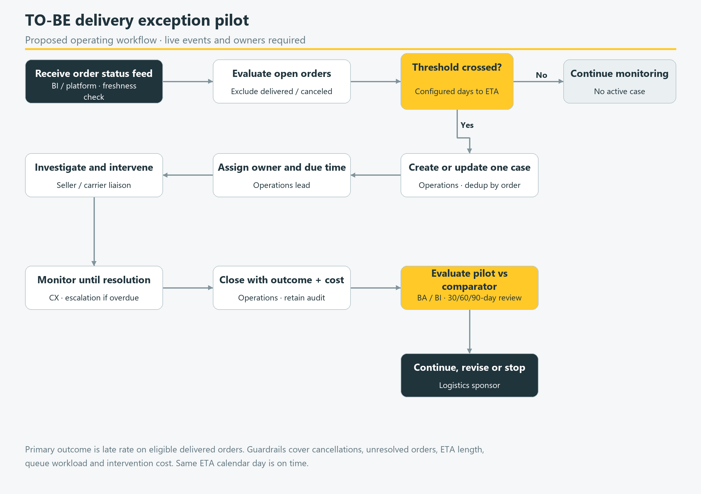

# TO-BE delivery exception pilot
Version 3.0 · 27 November 2026 · Historical portfolio exercise · Stakeholder decisions remain proposed.
## Intended outcome

Test whether earlier operational attention reduces missed calendar-date promises in an actionable cohort. Historical analysis supplies a baseline. The live pilot must capture intervention and outcome events.

[Editable draw.io source](diagrams/to-be.drawio)

## Queue design

The proposed threshold is 3 calendar days before ETA. Logistics must validate this against actionable lead time and staffed capacity. An order enters the queue when it remains eligible and unconfirmed as delivered at the threshold. Delivered/canceled orders leave active work.

The case contains order_id, affected seller context, destination state, estimated date, source event time, flag time, threshold version, assigned owner, response deadline, actions, escalation and closure reason. The owner checks shipment evidence, selects an authorized action and records completion. Missing or stale feeds create an operational incident. Repeated refreshes preserve assignment and avoid duplicate cases or customer contacts.

No automatic seller sanction or premium-carrier decision is part of the proposed MVP. These decisions require shipment responsibility, contractual authority and cost evidence.

## Pilot selection and measurement

1. Identify operationally actionable candidate groups using absolute late volume and rate. SP and RJ are candidate destination groups with 1,820 and 1,495 historical calendar-late orders respectively. They are not an established origin–destination corridor.
2. Match the baseline to the pilot's calendar period, eligibility and status rules. Predefine how recent incomplete orders mature into the outcome sample.
3. Choose random assignment where feasible. Otherwise document a comparator and limitations, including seasonality and pre-period trends.
4. Calculate required sample size using the cohort baseline, smallest useful effect and chosen uncertainty/error criteria. Confirm staffing and follow-up before launch.
5. Monitor actual interventions, outcome and guardrails. Review progress at agreed operational intervals and make the expansion decision after the predefined observation window.

## Outcome and guardrail definitions

| Measure | Definition | Decision use |
|---|---|---|
| Primary late rate | Calendar-late / eligible delivered orders in assigned cohort | Compare treated and comparator with uncertainty |
| Terminal status mix | Delivered, canceled and unresolved outcomes by assignment | Detect survivorship or operational harm |
| Intervention coverage | Actioned eligible cases / eligible generated cases | Check whether intervention was actually delivered |
| Action timeliness | Cases completed before promise expiry / actioned cases | Assess mechanism |
| Review outcome | Mean per-order review with reviewed count and coverage | Secondary customer-experience outcome |
| Promise length | Purchase-to-ETA duration and promise changes | Detect apparent gains from longer promises |
| Operating burden | Open cases, handling time and intervention cost | Assess sustainable capacity and value |
| Feed quality | Event lag, missing events, duplicates and replay failures | Decide whether automation can continue safely |

## Benefit sizing

An illustrative 10% relative reduction on the overall historical 6.77% rate gives approximately 6.10%. Applying 10% to the historical 6,534 late orders gives about 653 orders across the full snapshot. Pilot avoided volume instead equals the selected cohort's expected late count multiplied by the measured relative reduction.

Financial benefit requires avoided operational cost, intervention cost and validated incremental contribution. GMV exposed to late orders is R$985,924.34 and cannot substitute for savings. Voucher review lift, repeat-purchase lift and annual financial benefits remain unestimated.

## Readiness and expansion gates

The accountable sponsor must accept metric interpretation, pilot eligibility, assignment/comparator, sample size, cost ceiling and stopping rules. Logistics must confirm owner capacity, escalation authority and event freshness. CX must approve communications and consent handling. BI must pass model parity and source-quality tests.

A failed freshness gate pauses automatic generation. Sustained overload narrows scope. Deteriorating cancellation, complaint, handling cost or ETA length triggers review. Expansion requires a measured useful effect, acceptable uncertainty and guardrails within agreed limits.
